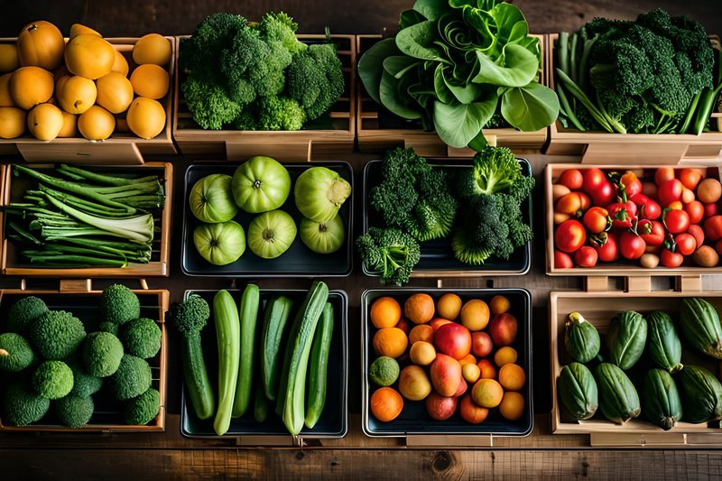

Agricultural Pricing
====================

This model sets the prices and demand for a country's dairy products in order to maximize the total revenue from their sales. Because revenue depends on price in a nonlinear way, the problem is formulated as a quadratic optimization model.

Access the Jupyter Notebook Modeling Example
--------------------------------------------

.. button-link:: https://colab.research.google.com/github/OWNER/REPO/blob/main/agricultural_pricing/agricultural_pricing.ipynb
   :color: primary
   :shadow:

   View Example

.. include:: _how-to-run.rst
