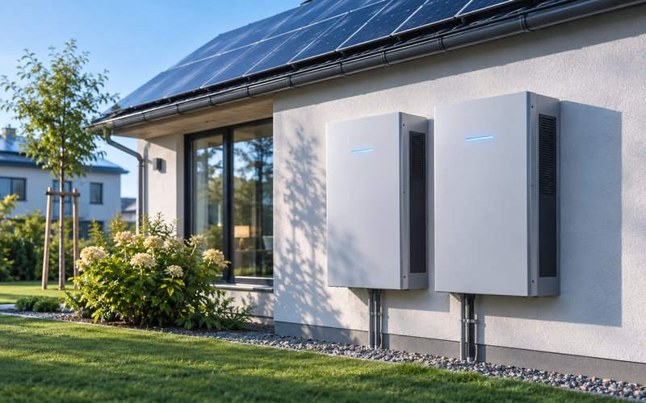

Battery Scheduling
==================

This example schedules a battery storage system alongside a load and a photovoltaic (PV) generator to reduce electricity costs. The notebook builds three models of increasing complexity, from load and PV alone to battery price arbitrage, and finally to an integrated model with nonlinear battery degradation costs.

Access the Jupyter Notebook Modeling Example
--------------------------------------------

.. button-link:: https://colab.research.google.com/github/OWNER/REPO/blob/main/battery_scheduling/battery_scheduling.ipynb
   :color: primary
   :shadow:

   View Example

.. include:: _how-to-run.rst
