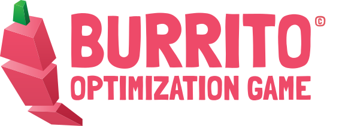

Gurobi's Burrito Optimization Game
==================================

The Burrito Optimization Game is an educational game designed to introduce students to the power of optimization. This example provides the optimization model behind the game, which helps players make decisions that satisfy the constraints of the scenario at the lowest cost.

Access the Jupyter Notebook Modeling Example
--------------------------------------------

.. button-link:: https://colab.research.google.com/github/OWNER/REPO/blob/main/burrito_optimization_game/burrito_optimization_game.ipynb
   :color: primary
   :shadow:

   View Example

.. include:: _how-to-run.rst
