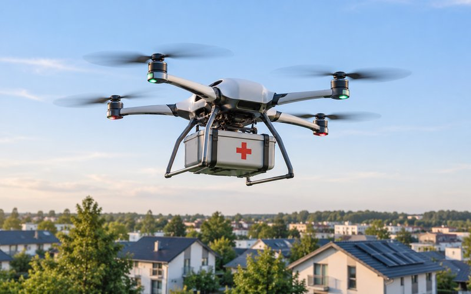

Drone-Network Design Queueing Model
===================================

This example designs a network of drone base stations that maximizes survival for time-sensitive medical events, such as out-of-hospital cardiac arrests. The model is a mixed-integer nonlinear program (MINLP) that accounts for queueing effects in the drone network.

Access the Jupyter Notebook Modeling Example
--------------------------------------------

.. button-link:: https://colab.research.google.com/github/OWNER/REPO/blob/main/drone_network/drone_network.ipynb
   :color: primary
   :shadow:

   View Example

.. include:: _how-to-run.rst
