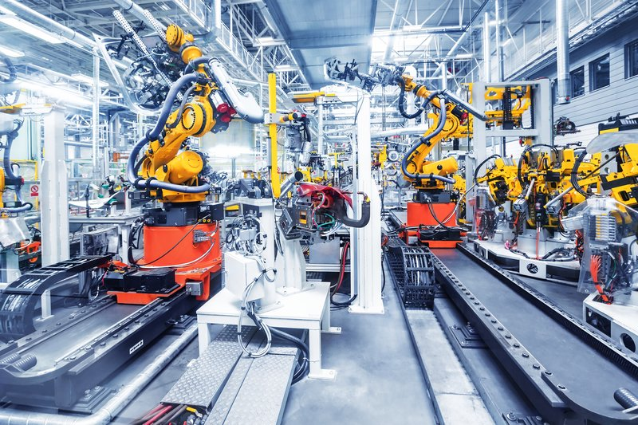

Factory Planning
================

This example is a production planning problem in which the goal is to create an optimal production plan that maximizes profit. The notebooks show how to formulate and solve the model with the Gurobi Python API.

Access the Jupyter Notebook Modeling Example
--------------------------------------------

.. button-link:: https://colab.research.google.com/github/OWNER/REPO/blob/main/factory_planning/factory_planning_1.ipynb
   :color: primary
   :shadow:

   View Example 1

.. button-link:: https://colab.research.google.com/github/OWNER/REPO/blob/main/factory_planning/factory_planning_2.ipynb
   :color: primary
   :shadow:

   View Example 2

.. include:: _how-to-run.rst
