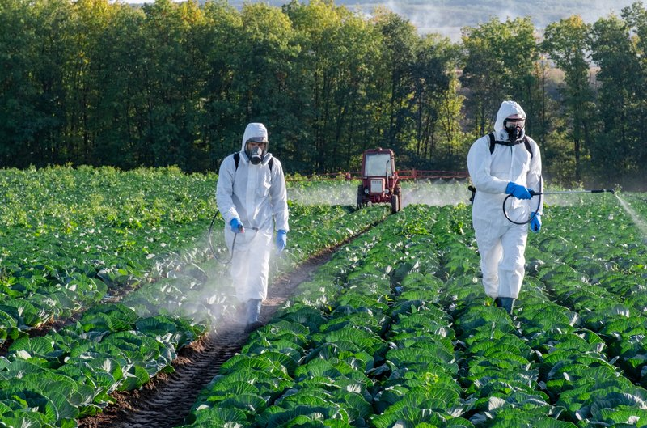

Farm Planning
=============

This example is a multi-period production planning problem that optimizes the operation of a farm over five years. The model is formulated as a linear program.

Access the Jupyter Notebook Modeling Example
--------------------------------------------

.. button-link:: https://colab.research.google.com/github/OWNER/REPO/blob/main/farm_planning/farm_planning.ipynb
   :color: primary
   :shadow:

   View Example

.. include:: _how-to-run.rst
