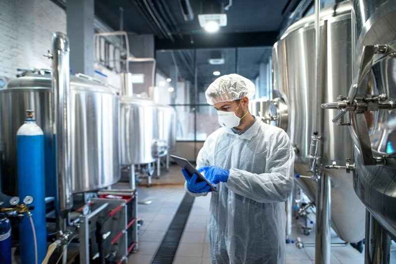

Food Manufacture
================

This example is a blending problem in which raw materials are combined to meet the stated constraints at the lowest cost. The first example formulates the model as a linear program, and the second adds binary variables and indicator constraints.

Access the Jupyter Notebook Modeling Example
--------------------------------------------

.. button-link:: https://colab.research.google.com/github/OWNER/REPO/blob/main/food_manufacturing/food_manufacture_1.ipynb
   :color: primary
   :shadow:

   View Example 1

.. button-link:: https://colab.research.google.com/github/OWNER/REPO/blob/main/food_manufacturing/food_manufacture_2.ipynb
   :color: primary
   :shadow:

   View Example 2

.. include:: _how-to-run.rst
