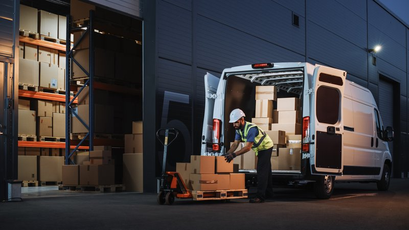

Lost Luggage Distribution
=========================

A small company with six vans collects lost or delayed baggage from several airlines and delivers each piece to its owner. This vehicle routing problem is formulated as a binary optimization problem that determines the routes of the vans.

Access the Jupyter Notebook Modeling Example
--------------------------------------------

.. button-link:: https://colab.research.google.com/github/OWNER/REPO/blob/main/lost_luggage_distribution/lost_luggage_distribution.ipynb
   :color: primary
   :shadow:

   View Example

.. include:: _how-to-run.rst
