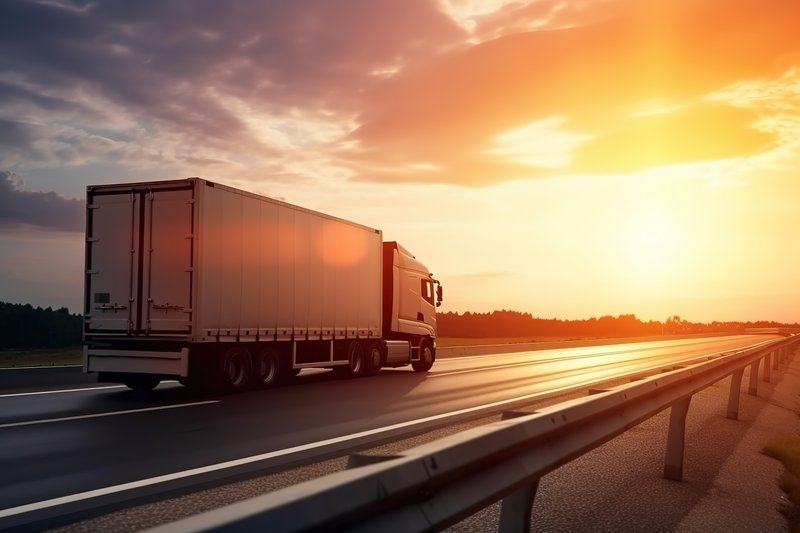

Milk Collection Problem
=======================

The milk collection problem is a capacitated vehicle routing problem in which one tanker lorry with limited capacity collects milk from a set of farms. The goal is to identify the optimal route for the tanker, and the problem is formulated as a binary optimization problem.

Access the Jupyter Notebook Modeling Example
--------------------------------------------

.. button-link:: https://colab.research.google.com/github/OWNER/REPO/blob/main/milk_collection/milk_collection.ipynb
   :color: primary
   :shadow:

   View Example

.. include:: _how-to-run.rst
