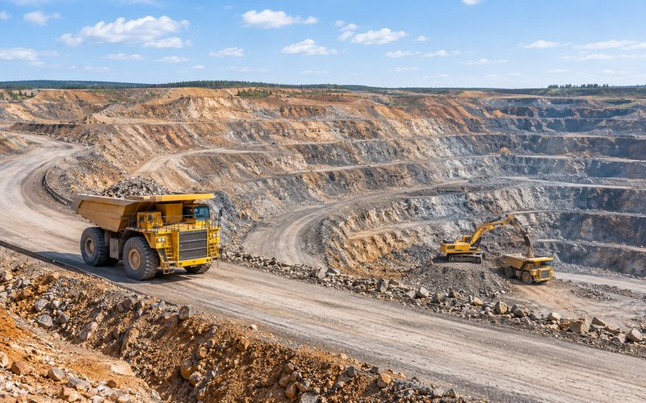

Mining
======

This example is a production planning problem in which choices must be made about which resources to use to produce which products. The goal is to maximize profit, and the model is a mixed-integer linear program.

Access the Jupyter Notebook Modeling Example
--------------------------------------------

.. button-link:: https://colab.research.google.com/github/OWNER/REPO/blob/main/mining/mining.ipynb
   :color: primary
   :shadow:

   View Example

.. include:: _how-to-run.rst
