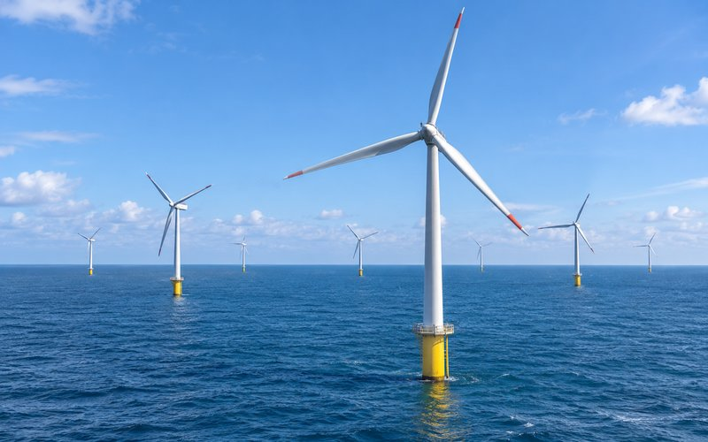

Offshore Wind Farming
=====================

This example minimizes the cost of laying the underwater cables that collect the electricity produced by an offshore wind farm. It constructs a mixed-integer programming model of this problem and computes an optimal solution with the Gurobi Optimizer.

Access the Jupyter Notebook Modeling Example
--------------------------------------------

.. button-link:: https://colab.research.google.com/github/OWNER/REPO/blob/main/offshore_wind_farming/offshore_wind_farming.ipynb
   :color: primary
   :shadow:

   View Example

.. include:: _how-to-run.rst
