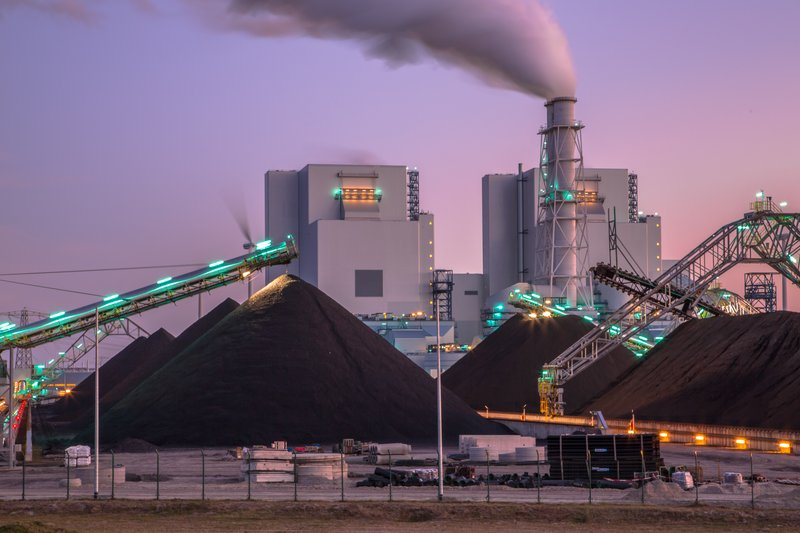

Opencast Mining
===============

A mining company must plan the extraction of ore from an opencast mine to maximize gross margins. The model is formulated as a linear program.

Access the Jupyter Notebook Modeling Example
--------------------------------------------

.. button-link:: https://colab.research.google.com/github/OWNER/REPO/blob/main/opencast_mining/opencast_mining.ipynb
   :color: primary
   :shadow:

   View Example

.. include:: _how-to-run.rst
