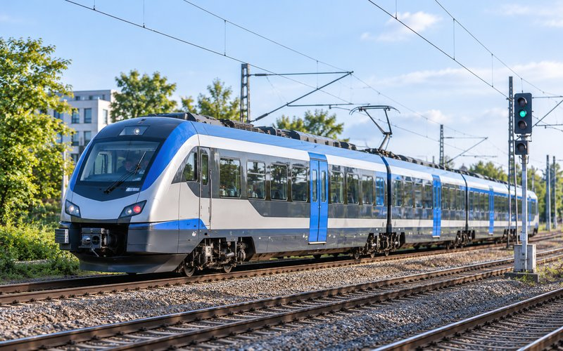

Railway Dispatching
===================

This example schedules trains on a railway network so that they run on time while respecting the capacity of shared track segments. The schedule is determined with a mixed-integer optimization model.

Access the Jupyter Notebook Modeling Example
--------------------------------------------

.. button-link:: https://colab.research.google.com/github/OWNER/REPO/blob/main/railway_dispatching/railway_dispatching.ipynb
   :color: primary
   :shadow:

   View Example

.. include:: _how-to-run.rst
