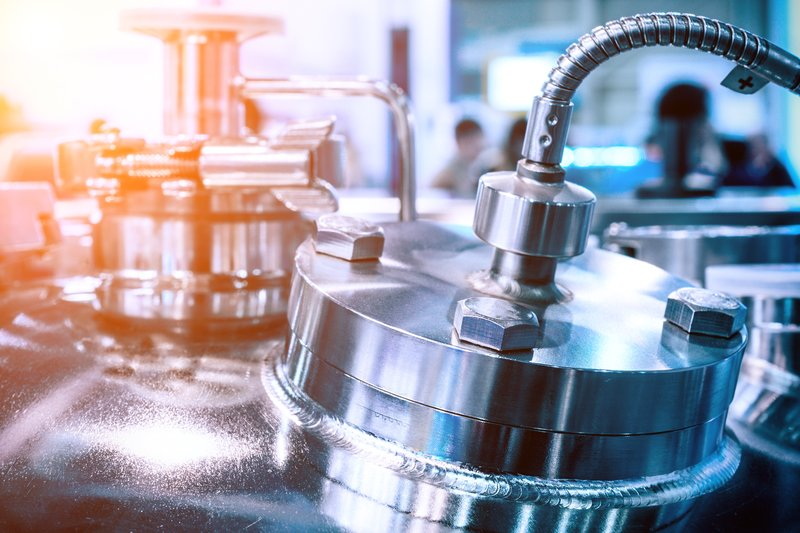

Semi-Batch Reactor Control
==========================

|

Feeding a reactor too fast is unsafe, feeding it too slowly wastes capacity. Gurobi computes the policy that maximizes yield within the safety limit.
-------------------------------------------------------------------------------------------------------------------------------------------------------

A semi-batch reactor starts out filled with reactant A; reactant B is then fed
in over time. The reaction is exothermic, so the feed rate is limited by a
safety requirement: if the cooling system failed, the accumulated reactants
must not drive the temperature above the allowed maximum.

The notebook discretizes the reactor dynamics and maximizes the amount of
product formed over a 64 hour batch, subject to the pump capacity, the reactor
volume and the cooling-failure temperature limit. The resulting feed profile is
then re-integrated with a proper ODE solver, so the error introduced by the
discretization can be assessed.

Access the Jupyter Notebook Modeling Example
--------------------------------------------

The examples will be published as Google Colab notebooks, a free online Jupyter
Notebook environment that allows you to write and execute Python code through
your browser.

.. note::

   Placeholder: the Colab link for
   ``notebooks/reactor_control/reactor_control.ipynb`` will be added here once
   the notebooks are published.

.. include:: _how-to-run.rst
