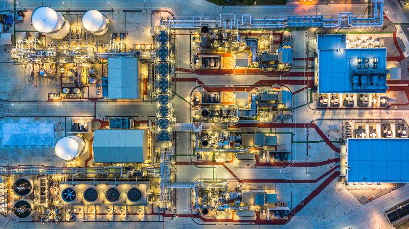

Reactor Network Design
======================

|

Choosing equipment and operating conditions at the same time is a mixed-integer nonlinear problem. Gurobi solves it directly.
--------------------------------------------------------------------------------------------------------------------------------

In a series reaction, the valuable intermediate degrades into a by-product if
the process runs too hot or too long. Designing a reactor network therefore
means trading reactor size, operating temperature and cooling duty against each
other, with reaction rates following the exponential Arrhenius law.

The notebook optimizes a superstructure with one mandatory and one optional
reactor. The model decides whether to install the second reactor, how large
each reactor should be, how the stream is split and at which temperature each
reactor operates, maximizing profit net of capital and cooling cost.

Access the Jupyter Notebook Modeling Example
--------------------------------------------

The examples will be published as Google Colab notebooks, a free online Jupyter
Notebook environment that allows you to write and execute Python code through
your browser.

.. note::

   Placeholder: the Colab link for
   ``notebooks/reactor_network/reactor_network_design.ipynb`` will be added here
   once the notebooks are published.

.. include:: _how-to-run.rst
